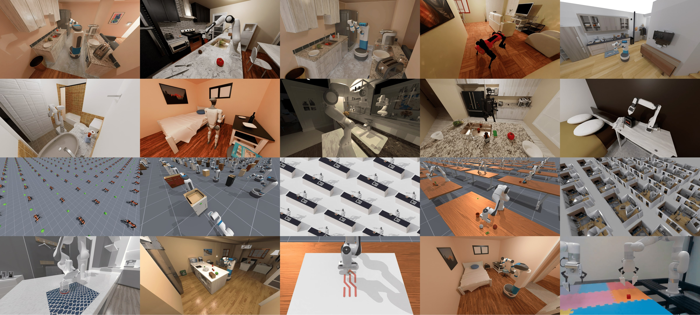

# ManiSkill 3 / Flow DP3：本地 AMD 12GB 环境指南



本仓库在 [ManiSkill 3](https://maniskill.readthedocs.io/en/latest/) 中独立接入 `flow_dp3`，点云编码器为 `ee_relation_pointnetpp`。目前接入十个单任务接口，每个任务独立训练，共用距离点云编码器和 Flow DP3 算法。任务选择、数据录制、训练、恢复和推理命令见 [introduce.md](introduce.md)，历史验证范围和后续计划见 [version.md](version.md)。

当前环境适配本地 **Ubuntu 22.04.5 + AMD Radeon RX 7700 XT 12GB**，运行方式为 **CPU 物理仿真 + Mesa CPU 软件 Vulkan 渲染 + ROCm 显卡策略计算**。

## 1. 从哪里开始

| 你的情况 | 阅读位置 |
| --- | --- |
| 在本机首次建立环境 | 本文第3节 → 第4节 → 第5节 |
| 已有本次建立的环境，重新打开终端 | [第4节：每次启动终端](#4-每次启动终端) |
| 选择任务，录制、训练、恢复或评估 | [introduce.md：实验操作与参数说明](introduce.md) |
| 安装或运行时报错 | [第7节：常见问题](#7-常见问题) |
| 查看模型输入和独立实现范围 | [第6节：代码与数据约定](#6-代码与数据约定) |

README 负责环境建立、依赖版本、设备检查和排错；introduce.md 负责已安装环境中的程序运行。两份文档均以项目根目录为工作目录。

## 2. 当前验证状态

以下为2026-11-10在本机完成的检查，验证任务为 PickCube-v1：

| 环节 | 当前结果 |
| --- | --- |
| 主机 | Ubuntu 22.04.5、内核6.8、i5-13600KF、32GB内存、RX 7700 XT 12GB（gfx1101） |
| 框架 | Python 3.12.12、PyTorch 2.9.1+rocm6.4；`pip check`通过 |
| 显卡与编码器 | `cuda:0`矩阵运算、编码器前向/反向及有限梯度检查通过 |
| CPU PhysX 与真实点云 | reset / step、512点采样、观测适配和编码通过；使用独立 Mesa 25.1.5 |
| 数据准备 | 已生成3条成功末端控制示范，每条通过40步成功保持 |
| 完整模型训练与恢复 | 原`[512,1024,2048]`主干，约2.55亿参数；FP32、batch size 2，完成10步训练并恢复到20步 |
| 显存 | 真实数据训练峰值约5.86GiB，PyTorch预留峰值约5.89GiB |
| 闭环评估与视频 | 2局、每局32步，成功率0/2；两段策略视频各33帧、一段专家视频115帧，均完成逐帧解码 |
| W&B / Open3D | 主流程使用本地日志；本机尚未验证 W&B 登录和 Open3D 交互窗口 |

20次更新只检查运行链路，不代表模型已收敛。100条示范、30000次更新和正式成功率评测尚未执行；其他任务的本机 ROCm 运行仍须逐项验收。

本地报告为 [local-12gb-validation.json](.runtime/reports/local-12gb-validation.json)，验收数据、完整模型权重和视频位于 `.runtime/flow_dp3/local-12gb-check/`。这些文件不随 Git 上传，新检出需重建环境、重新生成数据或单独导入备份。

## 3. 首次安装

以下命令用于已有 Conda 和可用 ROCm 驱动的本机终端。当前机器已完成安装，可直接跳到第4节；首次部署时将仓库路径和 Conda 路径替换成实际位置。

### 3.1 检查主机驱动和系统运行库

虚拟环境隔离 Python 依赖，显卡驱动与设备权限由主机提供。先检查：

```bash
cat /etc/os-release
id -nG
ls -l /dev/kfd /dev/dri
rocminfo
hipcc --version
```

本机已识别 gfx1101 / RX 7700 XT，ROCm为6.4，用户具有 render / video 设备权限。保留这套已可用驱动；主环境不安装 NVIDIA CUDA Toolkit。ROCm 版 PyTorch 复用 `torch.cuda` / `cuda:0`，可通过 `torch.version.hip`辨认底层框架。[PyTorch HIP 说明](https://docs.pytorch.org/docs/2.9/notes/hip.html)

系统库可先查询，仅在缺少时安装：

```bash
dpkg-query -W libgl1 libvulkan1 mesa-vulkan-drivers

# 缺少上述运行库时执行；vulkan-tools 仅供额外诊断使用。
sudo apt-get update
sudo apt-get install -y libgl1 libvulkan1 mesa-vulkan-drivers vulkan-tools
```

`libgl1`供 OpenCV 导入使用，`libvulkan1`提供 Vulkan loader。系统 Mesa 23.2 的软件渲染在本机未通过 SAPIEN 检查，第3.2节另外安装项目专用 Mesa，不替换系统图形驱动。PhysX 继续使用 CPU，ROCm 计算可用并不表示 PhysX GPU 仿真可用。

### 3.2 创建独立环境并固定核心版本

```bash
export MANISKILL_ROOT=/home/bigegg/ManiSkill
cd "$MANISKILL_ROOT"
source /home/bigegg/anaconda3/etc/profile.d/conda.sh
mkdir -p .runtime

conda create --prefix "$MANISKILL_ROOT/.runtime/env-rocm" \
    --override-channels --channel defaults --yes --copy \
    python=3.12.12 pip=26.0.1 setuptools=72.1.0 wheel=0.45.1
conda create --prefix "$MANISKILL_ROOT/.runtime/mesa-env" \
    --override-channels --channel defaults --yes --copy mesalib=25.1.5
conda activate "$MANISKILL_ROOT/.runtime/env-rocm"

# 避免继承其他 ROS / MuJoCo / Python 环境的模块与动态库路径。
unset PYTHONPATH LD_LIBRARY_PATH
export PYTHONDONTWRITEBYTECODE=1
export PIP_CONSTRAINT="$MANISKILL_ROOT/.runtime/constraints-rocm.txt"

cat > "$PIP_CONSTRAINT" <<'EOF'
torch==2.9.1+rocm6.4
torchvision==0.24.1+rocm6.4
numpy==1.26.4
scipy==1.14.1
sapien==3.0.3
gymnasium==0.29.1
mplib==0.1.1
pytorch_kinematics==0.7.6
einops==0.8.1
opencv-python==4.11.0.86
EOF
```

两个 Conda 环境均位于被 Git 忽略的 `.runtime/`内。日常只激活 env-rocm，通过 Vulkan ICD 文件调用 mesa-env 中的软件驱动。安装过程沿用 defaults 中的 Mesa 25.1.5；只有本机缓存完整时才可给创建命令增加 `--offline`。

本机 base 的 Python 3.13 和历史 DP3 的 Python 3.8 / SAPIEN 2 环境不作为当前项目环境。这里从独立 Python 3.12 开始，框架和依赖均安装到项目专用环境。

### 3.3 安装 ROCm 框架、项目依赖和源码

先安装指定的 ROCm wheel，再补齐仿真和训练依赖：

```bash
env -u PIP_EXTRA_INDEX_URL PIP_CONFIG_FILE=/dev/null \
    python -m pip install \
    --index-url https://download.pytorch.org/whl/rocm6.4 \
    --constraint "$PIP_CONSTRAINT" --timeout 600 --retries 3 \
    'torch==2.9.1+rocm6.4' 'torchvision==0.24.1+rocm6.4'

pip_install_public() {
    env -u HTTP_PROXY -u HTTPS_PROXY -u ALL_PROXY \
        -u http_proxy -u https_proxy -u all_proxy \
        -u PIP_PROXY -u PIP_EXTRA_INDEX_URL \
        PIP_CONFIG_FILE=/dev/null \
        PIP_INDEX_URL=https://mirrors.aliyun.com/pypi/simple/ \
        python -m pip install \
        --index-url https://mirrors.aliyun.com/pypi/simple/ \
        --constraint "$PIP_CONSTRAINT" --timeout 120 --retries 3 "$@"
}

pip_install_public -r examples/baselines/flow_dp3/requirements-probe.txt \
    -r examples/baselines/flow_dp3/requirements-train.txt
pip_install_public --no-deps --no-build-isolation -e .

python -m pip check
python -m pip freeze > .runtime/packages-rocm.txt
conda list --prefix "$MANISKILL_ROOT/.runtime/env-rocm" --explicit \
    > .runtime/conda-rocm-explicit.txt
conda list --prefix "$MANISKILL_ROOT/.runtime/mesa-env" --explicit \
    > .runtime/conda-mesa-explicit.txt
```

该框架版本对应 [PyTorch 官方 ROCm 6.4 安装组合](https://pytorch.org/get-started/previous-versions/)。torch 安装包约4.2GiB，有匹配的 pip 缓存可复用。公共 PyPI 镜像用于补齐本地依赖，无需云服务器账号；本机曾出现官方 PyPI 下载持续重试，切换公共镜像后完成安装。

requirements 文件适用于本地 env-rocm，使用本节独立安装的 ROCm PyTorch 和 constraints-rocm.txt。NumPy 固定1.26.4，OpenCV固定4.11.0.86，避免后续依赖把 NumPy 升到2。`--no-deps -e .`安装当前源码，不再次调整已验证依赖。

新终端需要继续安装公共包时，先执行第4节，再重新定义本节的 `pip_install_public`函数。环境约束、freeze 和 Conda 显式清单都是本地产物；迁移时单独备份，不能依赖 Git 自动传输。

### 3.4 可选：安装 W&B

本地 JSON 日志和 checkpoint 不依赖 W&B，introduce.md 主流程默认 `--wandb-mode disabled`。需要网页曲线时，在已激活的 env-rocm 中定义第3.3节安装函数，再执行：

```bash
pip_install_public -r examples/baselines/flow_dp3/requirements-logging.txt
python -m pip check
wandb login
python -m pip freeze > .runtime/packages-rocm-with-wandb.txt
```

现有可选依赖固定 `wandb==0.22.3`、`protobuf==3.20.3`、`click==8.1.7`；本机尚未安装并验证这一可选组合，安装后以实际 `pip check`和登录结果为准。W&B 0.22.3 支持超过40字符的 API key。[官方发布说明](https://github.com/wandb/wandb/releases/tag/v0.22.3)

### 3.5 可选：Open3D 交互可视化

Matplotlib 点云 PNG / MP4、专家录像和评估录像可使用主环境。Open3D 交互窗口、PLY 或 Open3D 导出后端需要额外依赖。在完成第3.2、3.3节后运行本地安装脚本：

```bash
bash visual/setup_env.sh
```

脚本使用 `.runtime/env-rocm/bin/python`创建 `.runtime/visual-venv`，复用主环境框架，并按 constraints-rocm.txt 安装可视化依赖。新增包只写入 visual-venv，不向主环境或系统 Python 安装包。下载源可通过 VISUAL_PIP_INDEX_URL 指定。

实际运行命令见 introduce.md 第2.4节和 [visual/README.md](visual/README.md)。本机已验证 Matplotlib PNG 导出与视频解码，Open3D 桌面交互尚未验收。

## 4. 每次启动终端

完成首次安装后，每个新终端执行以下初始化，再进入 introduce.md。Conda 安装位置或仓库路径不同的机器须相应替换。

```bash
export MANISKILL_ROOT=/home/bigegg/ManiSkill
cd "$MANISKILL_ROOT"
source /home/bigegg/anaconda3/etc/profile.d/conda.sh
conda activate "$MANISKILL_ROOT/.runtime/env-rocm"

unset LD_LIBRARY_PATH
export PYTHONPATH="$MANISKILL_ROOT"
export PYTHONDONTWRITEBYTECODE=1
export OMP_NUM_THREADS=1
export MKL_NUM_THREADS=1
export OPENBLAS_NUM_THREADS=1
export PIP_CONSTRAINT="$MANISKILL_ROOT/.runtime/constraints-rocm.txt"
export MS_ASSET_DIR="$MANISKILL_ROOT/.runtime/maniskill"
export MPLCONFIGDIR="$MANISKILL_ROOT/.runtime/matplotlib"
export XDG_CACHE_HOME="$MANISKILL_ROOT/.runtime/cache"
export MIOPEN_USER_DB_PATH="$MANISKILL_ROOT/.runtime/miopen"
export MIOPEN_CUSTOM_CACHE_DIR="$MANISKILL_ROOT/.runtime/miopen-cache"
export MANISKILL_VULKAN_ICD="$MANISKILL_ROOT/.runtime/mesa-env/share/vulkan/icd.d/lvp_icd.x86_64.json"
export VK_ICD_FILENAMES="$MANISKILL_VULKAN_ICD"

mkdir -p "$MS_ASSET_DIR" "$MPLCONFIGDIR" "$XDG_CACHE_HOME" \
    "$MIOPEN_USER_DB_PATH" "$MIOPEN_CUSTOM_CACHE_DIR" .runtime/flow_dp3 .runtime/reports
test -f "$PIP_CONSTRAINT"
test -f "$VK_ICD_FILENAMES"
```

此处使用项目内 Mesa 25.1.5 的 ICD；本机系统 `/usr/share/vulkan/icd.d/lvp_icd.x86_64.json`属于旧 Mesa 23.2，不能仅因文件存在就换回该路径。库依赖通过 Mesa 自身 RPATH 加载，无需把 mesa-env 的库目录全局加入 LD_LIBRARY_PATH。

单张显卡无需设置设备屏蔽变量；如终端曾配置 `CUDA_VISIBLE_DEVICES`、`HIP_VISIBLE_DEVICES`或 `ROCR_VISIBLE_DEVICES`，先检查是否隐藏了设备。ROCm 显卡计算和软件 Vulkan 渲染分别验证。

## 5. 安装后的验证

先执行第4节，在能访问本机设备的终端分别确认框架、仿真和真实点云：

```bash
python -B - <<'PYCODE'
import cv2, mani_skill, numpy, sapien, torch
print('ManiSkill:', mani_skill.__file__)
print('NumPy:', numpy.__version__, 'OpenCV:', cv2.__version__, 'SAPIEN:', sapien.__version__)
print('PyTorch:', torch.__version__, 'HIP:', torch.version.hip, 'CUDA build:', torch.version.cuda)
print('GPU available:', torch.cuda.is_available())
if torch.cuda.is_available():
    print('GPU:', torch.cuda.get_device_name(0))
PYCODE

python -B examples/baselines/flow_dp3/probe_runtime.py \
    --checks metadata torch-cpu encoder-cpu \
    --radius1 0.05 --radius2 0.12 \
    --output .runtime/reports/probe-cpu.json

python -B examples/baselines/flow_dp3/probe_runtime.py \
    --checks torch-gpu encoder-gpu \
    --num-points 512 --radius1 0.05 --radius2 0.12 --timeout 120 \
    --output .runtime/reports/probe-gpu.json

python -B examples/baselines/flow_dp3/probe_runtime.py \
    --checks sim pointcloud --render-backend cpu --steps 3 --timeout 120 \
    --num-points 512 --radius1 0.05 --radius2 0.12 \
    --output .runtime/reports/probe-sim-pointcloud.json
```

`torch-gpu` / `encoder-gpu`检查本地显卡计算和编码器，实际调用 `cuda:0`。报告中的 hip_build 用于记录 ROCm 构建版本。`torch.version.cuda is None`在 ROCm 版框架中正常，应结合 HIP 版本、设备名称和实际计算检查。

每项检查在独立子进程中运行，任何所选项失败时退出码为1。编码器检查包含前向、反向和有限梯度；点云检查包含相机有效点、坐标变换、裁剪、采样及关系编码器输出。`--steps`表示环境步数，`--timeout`是每项检查的超时秒数。

本机已出现沙箱看不到显卡设备、Mesa 点云子进程以 -11 退出，而相同点云命令在本机终端通过的情况；遇到设备或渲染异常时，先以本机终端复核，不能只据沙箱结果判断驱动不可用。

全部通过后，按 introduce.md 第3.6节检查完整模型的采集、batch size 2 训练、恢复和视频链路，再准备正式数据与长训练。可额外运行现有测试：

```bash
python -B -m unittest discover -s examples/baselines/flow_dp3/tests -v
```

该命令运行测试集合，不代表本次已完成全部测试。安装 W&B 后，真实 SDK 离线测试仍可能受沙箱 socket 权限影响；以本机终端结果为准。

## 6. 代码与数据约定

```text
ManiSkill/
├── README.md                         # 项目、环境与排错
├── introduce.md                      # 实验命令、参数与结果位置
├── mani_skill/                       # 仿真框架
├── examples/baselines/flow_dp3/
│   ├── ee_relation_encoder.py        # ee_relation_pointnetpp
│   ├── obs_adapter.py                # 采集和评估共享的观测适配器
│   ├── prepare_demos.py              # 原始轨迹生成、回放、成功过滤
│   ├── dataset.py                    # episode 划分与序列窗口
│   ├── policy.py / conditional_unet1d.py
│   ├── train.py / evaluate.py        # 训练、恢复、闭环评估与录像
│   ├── experiment_logging.py / import_training_logs.py
│   ├── configs/                     # 小模型与完整模型
│   ├── requirements-*.txt / tests/
│   └── PROVENANCE.md / LICENSE-DP3
└── .runtime/                         # 以下本地产物均不上传
    ├── env-rocm/                     # Python 3.12 / ROCm 训练环境
    ├── mesa-env/                     # Mesa 25.1.5 软件 Vulkan
    ├── visual-venv/                  # 可选 Open3D 环境
    ├── constraints-rocm.txt / packages-rocm.txt
    ├── conda-rocm-explicit.txt / conda-mesa-explicit.txt
    ├── reports/                     # 环境与链路验收报告
    └── flow_dp3/                    # 数据、权重、日志、视频
```

FlowDP3 在本仓库独立运行，不导入参考 benchmark，不共用其环境或 checkpoint。移植范围、算法来源与许可证见 [PROVENANCE.md](examples/baselines/flow_dp3/PROVENANCE.md)。

| 输入 / 输出 | 约定 |
| --- | --- |
| 点云 | 每帧 `[512,4]`；前三通道为 `(基座系点坐标 − 基座系末端坐标) / L`，第四通道为相对位移模长 `/ L` |
| 状态 | 28维：qpos 9、qvel 9、基座系末端位姿7（四元数 wxyz）、基座系目标位置3 |
| 动作 | PickCube训练默认ee/v5为7维 `pd_ee_delta_pose`；joint/v6为8维 `pd_joint_pos`（7个目标角度＋夹爪）；录制默认同时保存两种分支，历史v1/v2仍为4维平移动作 |
| 时间窗口 | 默认2帧观测、16步动作预测、每次执行8步动作 |
| 仿真 / 相机 | 单环境 CPU PhysX；PickCube 点云相机 256×256、60°，世界位置 `(0.30,-0.30,0.35)`、注视 `(0,0,0.12)`；软件 Vulkan |

相机原生 `xyzw` 的第四通道是有效点标记，适配器会重新构造距离通道。处理顺序为有效点过滤 → 世界系转基座系 → 操作区裁剪 → 预采样4096点 → FPS → 相对末端特征。默认 PickCube crop 为基座系 `min=(0.44,-0.23,-0.03)`、`max=(0.79,0.25,0.52)` 米，优先保留目标与末端，允许裁掉部分机械臂，排除背景地面。点数不足直接报错；点云不做逐通道 min-max 或每帧中心化。

任务相机和 [scene_bounds.py](examples/baselines/flow_dp3/scene_bounds.py) 共用 [task_pointcloud.py](mani_skill/utils/task_pointcloud.py) 的配置。FPS 的512点是整个裁剪后场景的总数，包含桌面/画布。分类通过渲染器的实体 segmentation ID 与采样索引核对，仅用于诊断，不参与模型采样。下表的相机位置与注视点是世界坐标，crop是基座坐标，均以米为单位；五台基座相机均为256×256，Peg保留原腕部相机。相机调整针对实验使用的Panda/PandaWristCam/PandaStick；其他机器人不套用这些操作区。

| 任务 | 基座系 crop 下界 | 基座系 crop 上界 | 世界系 eye → target | 垂直视场角 |
| --- | --- | --- | --- | --- |
| PickCube-v1 | `(0.44,-0.23,-0.03)` | `(0.79,0.25,0.52)` | `(0.30,-0.30,0.35)` → `(0,0,0.12)` | 60° |
| PushCube-v1 | `(0.40,-0.23,-0.03)` | `(1.06,0.25,0.52)` | `(0.30,-0.30,0.35)` → `(0.15,0,0.08)` | 75° |
| StackCube-v1 | `(0.36,-0.36,-0.03)` | `(0.87,0.36,0.52)` | `(0.30,0.35,0.28)` → `(0,0,0.07)` | 65° |
| PegInsertionSide-v1 | `(0.34,-0.40,-0.03)` | `(0.90,0.62,0.52)` | `(0.30,-0.35,0.55)` → `(0,0.10,0.12)` | 75° |
| DrawTriangle-v1 | `(0.28,-0.35,-0.03)` | `(0.80,0.18,0.52)` | `(0.25,-0.40,0.50)` → `(-0.10,-0.10,0.04)` | 60° |

点云接口可通过 `pointcloud_features(obs, agent, env_id="PegInsertionSide-v1")` 选择任务预设；显式传入的 `ObservationConfig` 优先，Draw支持PandaStick的TCP link。实验中可见目标在crop阶段全部保留，但整臂可能被裁去，后续预采样与FPS仍会丢失目标点。例如Pick原始方块中位数476点，FPS后11点；Draw仍有3/700帧目标轮廓被FPS完全丢弃。完整对照及取舍见 [实验报告](testpointcloud/MULTI_TASK_REPORT.md)。第一版正式数据转换与推理已接入这五个任务；状态/动作维度和运行命令见 [introduce.md](introduce.md)。

Stack实验录制显式使用`robot_uids="panda"`；任务原有默认机器人`panda_wristcam`保持不变，其`hand_camera`也保留。默认机器人拼接两台相机时，点数分布不能直接套用单相机实验表。

新录制的 PickCube 默认在同一 HDF5 中保存 `ee`（v5，7维）与 `joint`（v6，8维）两个分支；每个分支真实执行自己的动作、重新采集观测，并在到点后稳定保持40步。只有两个分支均成功的同源示范才保留，训练/验证按相同 episode 划分。录制默认每10条成功示范抽1条完整录像，即第1、11、21……条，两个分支使用相同编号，视频位于 `<数据集名称>-videos-full/{ee,joint}/*.mp4`。未选中轨迹跳过录像画面渲染和编码，训练数据全部逐步保存；`--video-every 1` 恢复每条录像，`--no-save-video` 完全关闭。训练使用 `--control-mode ee` 或 `--control-mode joint` 选择分支，并自动设置动作维度、范围与尾部填充；推理默认跟随 checkpoint，同名参数用于核对。两者 state 均为28维，点云仍使用实际 TCP 计算512×4矢量距离。使用说明与验证见 [双控制录制报告](testpointcloud/DUAL_CONTROL_REPORT.md)。

已单独备份的历史单分支 `testpointcloud/runs/pickcube-stability/pickcube-pose-hold-v5.h5`、`pickcube-joint-hold-v6.h5` 可以继续使用；新检出不包含这些运行产物。旧 v1/v2/v4 数据和 checkpoint 按保存的控制器、相机和采样规则加载，恢复旧训练使用原目录的配置。稳定保持修复与此前实验见 [稳定保持实验报告](testpointcloud/PICKCUBE_STABILITY_REPORT.md)。

训练和验证按整条 episode 划分，状态与动作归一化只使用训练 episode。模型输入包含任务目标位置；物体真值位姿、抓取状态和成功标记仅用于环境或数据检查。PickCube 正式配置、烟雾配置及策略缺省的 SA1/SA2 半径为 0.05 / 0.12 米，依据见 [半径实验](testpointcloud/SA_RADIUS_REPORT.md)，成功率仍需新训练验证。仅修改半径时点云数据可复用；改为7维位姿动作时需重新转换原始轨迹。旧 checkpoint 按保存的半径加载。其他任务配置暂保留 0.10 / 0.20 米。

## 7. 常见问题

### 7.1 导入失败或依赖警告

| 消息 / 场景 | 处理 |
| --- | --- |
| `ModuleNotFoundError` / 使用了错误 Python | 执行第4节，检查`which python`和`python -c "import sys; print(sys.prefix)"`；主环境应为`.runtime/env-rocm`。 |
| `ImportError: libGL.so.1` | 按第3.1节补齐系统 libgl1，再检查 cv2 导入。 |
| 导入时出现其他 ROS / MuJoCo / 旧 Python 路径 | 按第4节重设 PYTHONPATH、清除继承的 LD_LIBRARY_PATH，在项目专用终端中运行。 |
| NumPy / OpenCV 版本发生变化 | 按 constraints-rocm.txt 重新安装对应依赖，再执行 pip check；避免同时安装多个共享 cv2 命名空间的 OpenCV 发行包。 |
| Matplotlib / Fontconfig 缓存不可写 | 确认 MPLCONFIGDIR、XDG_CACHE_HOME 指向项目内可写目录，按第4节创建目录。 |
| `Name or service not known` / 下载重试 / 代理连接失败 | 区分网络错误与版本不匹配；第3.3节公共镜像函数只对当前安装命令绕过代理。torch 仍使用官方 ROCm 源或匹配缓存。 |
| `pip check`列出冲突 | 应检查具体依赖；本次安装后的 pip check 已通过。保留 constraints 和原环境清单再调整依赖。 |

### 7.2 仿真、渲染与设备可见性

| 消息 / 场景 | 处理 |
| --- | --- |
| `Failed to find a supported physical device "cpu"` | 检查 VK_ICD_FILENAMES 是否指向项目 mesa-env 中的 ICD；本机系统 Mesa 23.2 未通过，独立 Mesa 25.1.5 已通过。 |
| `failed to find a rendering device` / Vulkan 初始化失败 | 先检查 ICD 文件与对应动态库，再分别执行第5节 sim 和 pointcloud 检查。 |
| 显卡不可见 / `当前进程无法访问显卡` | 检查 ROCm 版 torch、rocminfo、/dev/kfd、/dev/dri 和用户设备权限。 |
| `torch.cuda.is_available()`为 False | 确认在主机终端、使用 env-rocm，检查 HIP 版本及设备屏蔽变量；先把设备可见性与模型算子兼容性分开排查。 |
| 沙箱点云子进程退出码 -11 | 使用相同环境变量在本机终端复核；本机已有沙箱失败、主机通过的验证记录。 |
| 无渲染 sim 检查仍创建材质 | 部分任务构造 RenderMaterial；这些任务即使关闭观测也可能需要可用的软件 Vulkan。 |

模型计算、物理仿真和相机渲染需要分别通过检查。当前本机验证采用 CPU PhysX 和 CPU Vulkan，AMD 硬件 Vulkan 渲染不在本次验收范围。[ManiSkill 安装文档](https://maniskill.readthedocs.io/en/latest/user_guide/getting_started/installation.html)

### 7.3 W&B 依赖

主流程使用 `--wandb-mode disabled`时不导入 W&B SDK。需要在线或离线日志，先按第3.4节安装，再按 introduce.md 第6节运行。安装可选包后重新执行 pip check，并保存新的 freeze。

发生依赖冲突时，先核对 constraints-rocm.txt 和实际导入路径，再按本机约束调整日志依赖；确认核心框架和仿真依赖未被替换后重新检查环境。

### 7.4 数据和实验输出已存在

数据输出、评估报告和同名视频拒绝覆盖；新训练输出目录必须为空。换一个实验编号或输出文件名。继续同一次训练使用 `--resume`，写回原目录，读取该目录保存的 config.yaml，并保持原数据、batch size 和计算环境。具体命令见 introduce.md。

示范、模型和日志需要单独备份或迁移。数据按任务契约检查，恢复训练使用原环境、数据和保存配置；更换计算设备或框架版本后，先独立验证权重加载和推理。

### 7.5 12GB 显存和 checkpoint 空间

本机完整模型、512点、FP32、batch size 2 的真实训练峰值约5.86GiB；这是短流程实测，不保证增加点数、批大小或修改网络后仍有相同占用。默认命令显式传 `--batch-size 2`，YAML 的原始 batch_size=32 保留，恢复时以原 run.json 的实际值为准。

完整 checkpoint 约3.9GiB，last.pt、best.pt 和写入中的临时文件均需空间。正式配置的定期保存间隔已从100调整为1000步；验证 loss 改善和最后一步仍会额外保存，并非每1000步才可能写盘。烟雾配置仍保留10步间隔；已有实验继续使用其保存的配置。

环境、数据和实验输出均位于被 Git 忽略的 `.runtime/`。备份范围与重建步骤见 introduce.md 第7节。

## 8. 上游资料与引用

- [ManiSkill 官方文档](https://maniskill.readthedocs.io/en/latest/) 与 [示例](https://maniskill.readthedocs.io/en/latest/user_guide/demos/index.html)
- [ManiSkill3 论文](https://arxiv.org/abs/2410.00425)
- [DP3 论文](https://arxiv.org/abs/2403.03954) 与 [项目](https://3d-diffusion-policy.github.io/)
- [FlowDP3 移植来源](examples/baselines/flow_dp3/PROVENANCE.md) 与 [DP3 许可证](examples/baselines/flow_dp3/LICENSE-DP3)

使用 ManiSkill3 时引用：

```bibtex
@article{taomaniskill3,
  title={ManiSkill3: GPU Parallelized Robotics Simulation and Rendering for Generalizable Embodied AI},
  author={Stone Tao and Fanbo Xiang and Arth Shukla and Yuzhe Qin and Xander Hinrichsen and Xiaodi Yuan and Chen Bao and Xinsong Lin and Yulin Liu and Tse-kai Chan and Yuan Gao and Xuanlin Li and Tongzhou Mu and Nan Xiao and Arnav Gurha and Viswesh Nagaswamy Rajesh and Yong Woo Choi and Yen-Ru Chen and Zhiao Huang and Roberto Calandra and Rui Chen and Shan Luo and Hao Su},
  journal={Robotics: Science and Systems},
  year={2025}
}
```

ManiSkill 代码见 [LICENSE](LICENSE)，资产与第三方组件分别遵循其许可证，参见 [LICENSE-3RD-PARTY](LICENSE-3RD-PARTY)。
